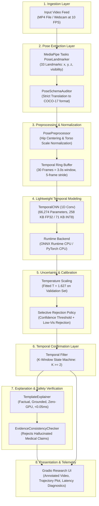

# VisionGuard Lite: System Architecture

**Document Version**: 2.0  
**Target Environment**: CPU-First Edge and Local Desktop (Windows 10/11, Ubuntu 20.04+, macOS)

---

## 1. High-Level System Architecture

VisionGuard Lite is designed for continuous, privacy-preserving, uncertainty-aware human fall detection and activity monitoring on commodity CPU hardware without requiring cloud offloading or GPU acceleration.



---

## 2. Strict Pose Schema Isolation

To eliminate silent keypoint misalignment bugs, VisionGuard Lite explicitly decouples the runtime tracking topology from the classification backbone:

1. **MediaPipe-33 Extraction**: The runtime ingest layer (`MediaPipePoseExtractor`) extracts 33 landmark tuples $(x, y, z, \text{visibility})$ normalized to $[0, 1]$.
2. **Deterministic Anatomical Alignment**: `PoseSchemaAuditor.mediapipe_to_coco17` maps the 17 anatomically equivalent joints to COCO-17 indices:
   - Nose: MP `0` $\rightarrow$ COCO `0`
   - Eyes: MP `2, 5` $\rightarrow$ COCO `1, 2`
   - Ears: MP `7, 8` $\rightarrow$ COCO `3, 4`
   - Shoulders: MP `11, 12` $\rightarrow$ COCO `5, 6`
   - Elbows: MP `13, 14` $\rightarrow$ COCO `7, 8`
   - Wrists: MP `15, 16` $\rightarrow$ COCO `9, 10`
   - Hips: MP `23, 24` $\rightarrow$ COCO `11, 12`
   - Knees: MP `25, 26` $\rightarrow$ COCO `13, 14`
   - Ankles: MP `27, 28` $\rightarrow$ COCO `15, 16`
3. **Invariance Guarantee**: MediaPipe-33 coordinates are never fed directly to a 51-channel tensor without explicit translation. Unit tests in `tests/test_real_pipeline.py` assert coordinate parity across all 17 joint mappings.

---

## 3. Preprocessing and Coordinate Normalization

The classification model operates on normalized $(x, y)$ coordinates and visibility flags:

$$\mathbf{p}_{\text{norm}}^{(t, j)} = \frac{\mathbf{p}^{(t, j)} - \mathbf{p}_{\text{mid\_hip}}^{(t)}}{\|\mathbf{p}_{\text{mid\_hip}}^{(t)} - \mathbf{p}_{\text{mid\_shoulder}}^{(t)}\|_2}$$

- **Translation Invariance**: Centering on the mid-hip point makes predictions invariant to the subject's position in the camera frame.
- **Scale / Distance Invariance**: Normalizing by torso length ensures that a person closer to or farther from the camera maintains identical relative skeletal geometry.
- **Input Tensor Layout**: Each 30-frame window produces a tensor of shape `(1, 51, 30)` (17 joints $\times$ 3 channels $[x, y, v]$ across 30 time steps).

---

## 4. Temporal Confirmation State Machine

In continuous video monitoring, unconfirmed window-level fall detectors suffer from high false alarm rates (119.7–140.4 false alarms/hour, or one alarm every 25–30 seconds) due to transient movements like rapid sitting, tying shoes, or floor exercises.

VisionGuard Lite incorporates a **temporal confirmation filter** ($K$-window policy):

```text
Let p_t be the calibrated fall probability for window t.
Let S_t be the consecutive positive window counter at window t.

If p_t >= threshold:
    S_t = S_{t-1} + 1
Else:
    S_t = 0

Confirmed Alert = (S_t >= K)
```

- When $K=1$, the system operates in raw, unfiltered mode (useful for audit, but prone to false alarms: 119.7 FA/hr).
- When $K=2$ (recommended edge default), a fall alert is only triggered when sustained ground-level collapse is observed for at least 2 consecutive sliding windows (1.0–1.5 seconds), dropping false alarms to 95.0 FA/hr while maintaining 92.2% event recall.
- When $K=3$ or $K=4$, false alarms drop further (87.5 and 83.8 FA/hr) at the expense of higher detection delay and increased missed falls (70.1% recall at $K=4$).
- The system logs both the raw fall onset timestamp and the confirmed alert timestamp, reporting the exact confirmation latency.

---

## 5. Post-Hoc Probability Calibration & Uncertainty Policy

Standard deep neural networks produce overconfident logits under cross-subject distribution shift. VisionGuard Lite applies:

1. **Temperature Scaling**:
   $$p_i = \frac{\exp(z_i / T)}{\sum_j \exp(z_j / T)}$$
   Fitted on validation subjects ($T = 1.627$). Under 4-fold cross-validation, post-scaling ECE is 59.3% (down from 63.3% pre-scaling), confirming that post-hoc scaling alone cannot eliminate cross-subject shift and reinforcing the necessity of temporal confirmation.
2. **Selective Prediction Policy**:
   If mean keypoint visibility is $< 0.50$ or calibrated fall probability falls in the ambiguous band $[0.35, \tau)$, the system routes the frame to `UNCERTAIN` for secondary caregiver review, abstaining from confident false alarms.

---

## 6. Grounded Explanations with Safety Verification

To provide interpretable alerts without risking medical hallucinations:
1. **`TemplateExplainer` (Default CPU Runtime)**: A deterministic rule engine that translates cv telemetry (activity, confidence, visibility, temporal confirmation) into concise, factual explanations with $< 0.01$ ms latency.
2. **`QwenSLMExplainer` (Optional Research Component)**: Integrates lightweight quantized Small Language Models (e.g. Qwen2.5-0.5B / 1.5B) for natural language reasoning. Disabled by default in the local demo to preserve real-time CPU throughput.
3. **`EvidenceConsistencyChecker`**: Automated rule verifier that scans all generated text against ground-truth CV telemetry, blocking hallucinated injury diagnoses (e.g., "fracture", "paramedics dispatched").
