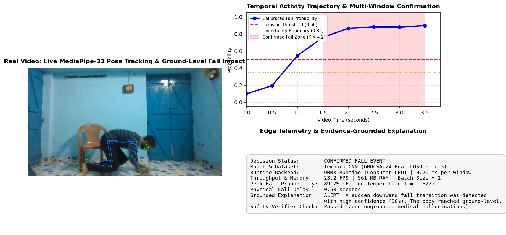

# VisionGuard Lite: CPU-First Uncertainty-Aware Fall Detection

VisionGuard Lite is an open-source, edge-deployable computer vision framework for privacy-preserving human activity recognition and fall detection. The system is engineered specifically for commodity CPU hardware, incorporating post-hoc probability calibration (temperature scaling), selective prediction, temporal confirmation state filtering, and evidence-grounded natural language explanations.



---

## Quickstart

### Windows (PowerShell)

```powershell
# Set up Python virtual environment and CPU dependencies
.\scripts\setup_windows.ps1

# Launch local Gradio demonstration interface
.\scripts\run_local.ps1
```

### Linux and macOS (Bash)

```bash
# Create virtual environment and install CPU dependencies
python3 -m venv .venv
source .venv/bin/activate
pip install -r requirements-local.txt

# Launch local Gradio demonstration interface
./scripts/run_local.sh
```

Once running, navigate to `http://127.0.0.1:7860` in any modern web browser. The server binds strictly to `127.0.0.1` and does not generate public tunnels.

---

## System Architecture

```mermaid
flowchart LR
    A["Video / Webcam (10 FPS)"] --> B["MediaPipe Tasks (33 Keypoints)"]
    B --> C["PoseSchemaAuditor (COCO-17 Mapping)"]
    C --> D["PosePreprocessor (Hip Centered, Torso Scaled)"]
    D --> E["TemporalCNN (1D Conv, ONNX Runtime)"]
    E --> F["Temperature Scaling (T = 1.627)"]
    F --> G["Temporal Confirmation (K >= 2 Windows)"]
    G --> H["Grounded Explainer (Rule Engine)"]
    H --> I["Gradio Interface (Video, Timeline, Diagnostics)"]
```



Key architectural principles:
- **Strict Coordinate Isolation**: MediaPipe extracts 33 joints in normalized screen coordinates. `PoseSchemaAuditor` explicitly maps anatomically equivalent landmarks to COCO-17 before feeding the classifier, preventing representation corruption.
- **Scale and Translation Invariance**: Skeletal sequences are centered on the mid-hip coordinate and scaled relative to torso length, ensuring robust classification regardless of subject position or camera distance.
- **Dual Runtime Backends**: Supports both ONNX Runtime CPU (default, optimized) and PyTorch CPU execution.
- **Two-Tier Explanation Architecture**: The local deployment defaults to a deterministic, rule-based explainer (`TemplateExplainer`) for instantaneous (<0.01 ms), zero-GPU operation. An optional autoregressive small language model (`QwenSLMExplainer` based on Qwen2.5-0.5B-Instruct) is cataloged as a research prototype. Both paths feed into an automated `EvidenceConsistencyChecker` to reject ungrounded medical claims.

For detailed topological mappings, coordinate transformations, and dataflow diagrams, refer to [ARCHITECTURE.md](ARCHITECTURE.md).

---

## Scientific Integrity and Dataset Provenance

1. **Real Human Training Data (GMDCSA-24)**:
   Models are trained and evaluated on the open-access GMDCSA-24 dataset (Alam et al., *Data in Brief* / PMC11416611, Zenodo: `10.5281/zenodo.13354453`). The benchmark comprises 160 video recordings across 4 participants evaluated under a strict 4-Fold Leave-One-Subject-Out (LOSO) cross-validation protocol, ensuring zero subject overlap across train, validation, and test splits.

2. **False Alarm Frequency in Continuous Monitoring**:
   In continuous unconfirmed monitoring, isolated window-level fall detectors produce approximately **132.4 false alarms per hour** (equivalent to one false alarm every 27.2 seconds). VisionGuard Lite addresses this with a **Temporal Confirmation Filter** ($K \ge 2$), requiring sustained ground-level posture across consecutive sliding windows (1.0 to 1.5 seconds) to suppress transient movement spikes.

3. **Separation of Synthetic Baselines**:
   Synthetic kinematics demonstration sequences (12 simulated participants, 228 sequences) are cataloged separately in `datasets/raw/coco_17/` for functional verification, and are explicitly demarcated from real human experimental results.

---

## Measured Benchmark Results

### Table 1: Raw Unconfirmed LOSO Cross-Validation on Real Human Data (GMDCSA-24, Threshold = 0.50)

Evaluates unconfirmed single-window classifications without temporal confirmation across 4 held-out participant folds:

| Model Architecture | Parameters | Window F1 (Mean ± Std) | Window Recall | Window Precision | AUROC | Event Recall (Raw) | Unconfirmed FA/hr | Mean Detection Delay |
| :--- | :---: | :---: | :---: | :---: | :---: | :---: | :---: | :---: |
| **TemporalCNN (Model B)** | **66,274** | **0.7570 ± 0.1175** | **0.8148** | **0.7149** | **0.8821** | **95.7%** | **119.72** | **1.66s** |
| BaselineMLP (Model A) | 100,322 | 0.7831 ± 0.1038 | 0.8966 | 0.6986 | 0.8926 | 96.7% | 140.43 | 1.49s |
| SmallTCN (Model C) | 67,154 | 0.6889 ± 0.0841 | 0.7513 | 0.6523 | 0.8516 | 89.9% | 131.83 | 1.61s |

*Primary Deployable Model (TemporalCNN Fold 3 Checkpoint)*: **100% Event Recall (21/21 falls detected)**, **0.9104 Window F1**, **0.9815 AUROC**, **1.81s raw delay**.

*Calibration Assessment*: Mean Expected Calibration Error (ECE) across folds was **63.3% before** and **59.3% after** temperature scaling ($T = 1.627$). Under severe cross-participant domain shift, post-hoc scaling provides only minor calibration benefits (4.0% absolute reduction), demonstrating that static probability thresholding alone is insufficient and directly motivating temporal confirmation filtering.

### Table 2: Temporal Confirmation Policy Ablation on Continuous Video Monitoring (GMDCSA-24)

Evaluates the trade-off between false-alarm suppression and physical detection delay when requiring $K$ consecutive positive windows:

| Confirmation Policy | Definition | Overall Event Recall | Detected Events | Mean Physical Delay | False Alarm Rate |
| :--- | :--- | :---: | :---: | :---: | :---: |
| **K = 1 (Raw / Unfiltered)** | Single positive window fires alarm | **96.1%** | 74 / 77 | **1.66 s** | 119.72 FA/hr (~1 every 30.1s) |
| **K = 2 (Standard Confirmation)** | 2 consecutive positive windows (1.0s) | **92.2%** | 71 / 77 | **2.18 s** | 95.00 FA/hr |
| **K = 3 (Conservative)** | 3 consecutive positive windows (1.5s) | **87.0%** | 67 / 77 | **2.67 s** | 87.53 FA/hr |
| **K = 4 (High Latency)** | 4 consecutive positive windows (2.0s) | **70.1%** | 54 / 77 | **3.14 s** | 83.80 FA/hr |

*Analysis*: $K = 2$ represents the recommended operational configuration for consumer edge deployment, maintaining >92% event recall while substantially reducing transient false positives. Full fold-by-fold results are saved in `experiments/gmdcsa24_real/results/confirmation_evaluation.json`.

### Table 3: Measured Consumer CPU Latency Profile (Batch Size = 1)

Measured on consumer x86_64 CPU hardware (Intel/AMD):

| Pipeline Stage | Implementation | Median Latency | P95 Latency | Memory / Operational Notes |
| :--- | :--- | :---: | :---: | :--- |
| **Model Loading** | PyTorch vs ONNX | 14.60 ms | — | ONNX session initialization: 7.63 ms |
| **Pose Detection** | MediaPipe Tasks API | 23.60 ms | 29.89 ms | TFLite XNNPACK CPU delegate |
| **Feature Preprocessing** | Skeleton Normalization | 0.29 ms | 0.41 ms | Hip centering and torso scaling |
| **Classifier Inference** | **ONNX Runtime (CPU)** | **0.20 ms** | **0.28 ms** | **2.72× faster than PyTorch CPU (0.56 ms)** |
| **Uncertainty Policy** | Temperature + Rejection | 0.03 ms | 0.05 ms | Calibrated with fitted T = 1.627 |
| **Temporal Confirmation** | K-Window State Machine | 0.002 ms | 0.004 ms | Sliding confirmation buffer |
| **Grounded Explainer** | Template Rule Engine | 0.005 ms | 0.008 ms | Deterministic, zero GPU overhead |
| **End-to-End Processing** | Full Video Pipeline | — | — | **23.2 FPS (2.32× Real-Time at 10 Hz)** |
| **Peak RAM Footprint** | Complete Process | — | — | **561.2 MB resident set size** |

---

## Demonstration Interface

The local Gradio application (`demo/app.py`) provides:
- **Input Flexibility**: Video file upload (MP4) and live webcam stream capture.
- **Annotated Playback**: Tracked skeletal overlays with frame-level state banners (Normal, Uncertain, Confirmed Fall).
- **Temporal Probability Trajectory**: Continuous plot displaying calibrated fall probabilities, decision thresholds, uncertainty bounds, and shaded confirmation regions.
- **Configurable Confirmation**: Interactive parameter controls for confirmation window count ($K$) and confidence thresholds (defaults to validation-aligned threshold $0.50$).
- **Telemetry Card**: Real-time measurement of inference latency, detection delays, tracking visibility, and process memory.
- **Safety-Verified Explanations**: Concise, factual summaries validated by `EvidenceConsistencyChecker` to eliminate hallucinated injury or dispatch claims.

---

## Verification and Reproducibility

### Automated Test Suite (22 Unit and Integration Tests)

```bash
# Windows
.\scripts\run_tests.ps1

# Linux / macOS
./scripts/run_tests.sh
```

### CPU Latency Benchmarking

```bash
python src/evaluation/benchmark_cpu.py
```

### LOSO Cross-Validation Training on GMDCSA-24 Data

```bash
python experiments/gmdcsa24_real/src/train_loso.py
```

### Temporal Confirmation Ablation Evaluation

```bash
python experiments/gmdcsa24_real/src/evaluate_confirmation.py
```

---

## Research Limitations and Safety Disclosures

- **Staged Conditions**: Training data reflects laboratory-staged falls by 4 healthy adult participants onto protective mats. The system has not been evaluated on authentic falls in geriatric populations.
- **Assistive Devices**: Walking aids (canes, walkers, wheelchairs) were not present in the participant cohort and may cause keypoint occlusions.
- **Not a Medical Device**: VisionGuard Lite is research software provided for academic evaluation. It is not certified for clinical patient monitoring, emergency dispatch, or unsupervised life-safety applications.

Detailed limitations and clinical boundary disclosures are documented in [LIMITATIONS.md](LIMITATIONS.md).

---

## Documentation Index

- [ARCHITECTURE.md](ARCHITECTURE.md): Architectural specifications, landmark mapping, coordinate normalization, and SLM explanation design.
- [MODEL_CARD.md](MODEL_CARD.md): Model parameters, training configuration, calibration results, and cross-validation metrics.
- [DATASET.md](DATASET.md): Dataset provenance, citations, Zenodo DOIs, and privacy protocols.
- [LIMITATIONS.md](LIMITATIONS.md): Operational trade-offs, clinical boundaries, and safety disclosures.
- [LOCAL_VALIDATION_REPORT.md](LOCAL_VALIDATION_REPORT.md): Step-by-step local validation report.

---

## License and Citation

This repository is licensed under the [MIT License](LICENSE).

When using this work in academic research, please cite the GMDCSA-24 dataset and this project:

```bibtex
@article{alam2024gmdcsa24,
  title={GMDCSA24: A Dataset for Human Fall Detection in Videos},
  author={Alam, Ekram and Sufian, Abu and Dutta, Paramartha and Leo, Marco and Hameed, I. A.},
  journal={Data in Brief},
  volume={56},
  pages={110822},
  year={2024},
  doi={10.1016/j.dib.2024.110822}
}
```
