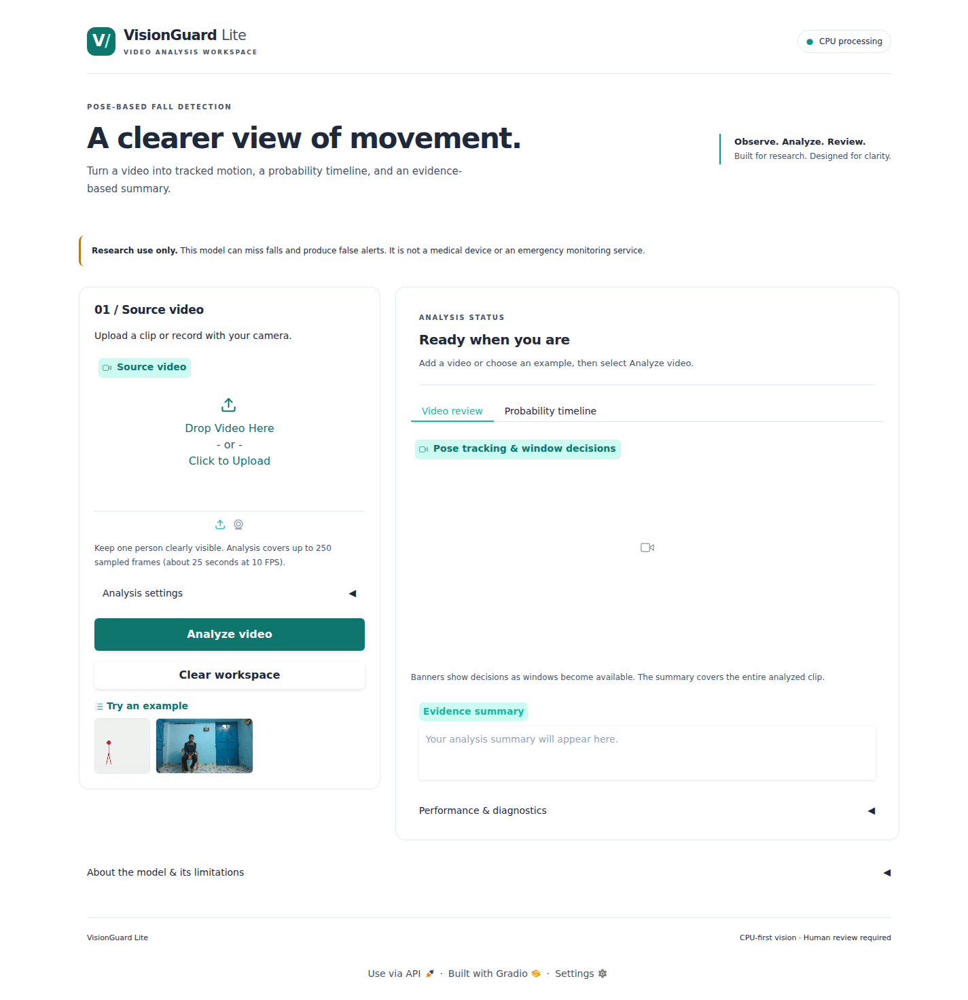
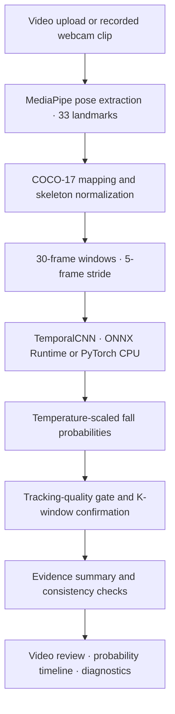

# VisionGuard

CPU-based fall-detection research from human pose sequences. Analyze a recorded video or webcam clip with a lightweight temporal classifier, inspect its probability timeline, and review an explanation that acknowledges uncertainty.

[](https://github.com/Madhumasa84/VisionGuard/actions/workflows/tests.yml)
[](pyproject.toml)
[](LICENSE)

**Research software, not a medical device.** The model can miss falls and produce frequent false alerts. It has not been validated for clinical use, emergency dispatch, or unsupervised safety monitoring. See [limitations](docs/limitations.md).



## Overview

- **Local CPU inference:** ONNX Runtime by default, with a PyTorch CPU backend for comparison. No hosted inference API is required.
- **Pose-based classification:** MediaPipe landmarks are mapped to COCO-17, normalized, and analyzed by a 66,274-parameter TemporalCNN.
- **Explicit uncertainty:** Temperature scaling, tracking-quality checks, and consecutive-window confirmation help distinguish model predictions from reliable evidence.
- **Reviewable results:** Annotated playback, a probability timeline, an evidence summary, and performance diagnostics in a responsive Gradio interface.
- **Reproducible research:** Bundled model artifacts, subject-separated experiment outputs, and automated unit and integration tests.

## Quick start

Requires Python 3.10 or later. Install FFmpeg for browser-compatible video conversion. On Linux, MediaPipe may also require system EGL/GLES libraries; see [setup and troubleshooting](docs/setup.md).

### Linux and macOS

```bash
git clone https://github.com/Madhumasa84/VisionGuard.git
cd VisionGuard
python3 -m venv .venv
source .venv/bin/activate
python -m pip install -r requirements-local.txt
./scripts/run_local.sh
```

### Windows PowerShell

```powershell
git clone https://github.com/Madhumasa84/VisionGuard.git
cd VisionGuard
.\scripts\setup_windows.ps1
.\scripts\run_local.ps1
```

Open **http://127.0.0.1:7860**. The launcher binds to the loopback address and leaves public sharing disabled by default.

1. Upload an H.264 MP4 or WebM, record a webcam clip, or choose an example.
2. Keep the default threshold of **0.50** and confirmation setting of **K=2** to start.
3. Select **Analyze video** and inspect the summary, annotated playback, and timeline.
4. Review pose visibility and uncertainty before interpreting a model prediction.

The demo processes up to **250 sampled frames**, targeting 10 FPS (approximately 25 seconds). Webcam input records a clip; it does not provide continuous live monitoring. Uploaded videos are processed on the host running the app, and generated outputs are written to the system temporary directory. Raw footage remains part of the local workflow; pose-based inference does not make uploaded video anonymous.

## Architecture



Windows with mean pose visibility below 50% cannot contribute to confirmation. Low clip-wide visibility produces an uncertain result even when the classifier probability is high. A confirmed event means the selected policy was satisfied; it does not verify a physical fall or injury.

The displayed **confirmation policy delay** starts at the first positive window in the confirming run. It is distinct from delay measured against an annotated physical fall onset. The [architecture reference](docs/architecture.md) describes module ownership, data shapes, and decision rules.

## Project structure

```text
VisionGuard/
├── demo/                       # Gradio application and bundled example clip
│   ├── app.py                  # Pipeline orchestration and local launcher
│   ├── ui.py                   # Interface layout and result presentation
│   └── style.css               # Responsive interface styles
├── src/                        # Reusable Python implementation
│   ├── data/                   # Schemas, ingestion, preprocessing, pose mapping
│   ├── models/                 # TemporalCNN, BaselineMLP, and SmallTCN
│   ├── inference/              # Pose extraction, ONNX export, explanations
│   ├── evaluation/             # Metrics, calibration, CPU benchmarks
│   └── training/               # Training loops and experiment orchestration
├── tests/                      # Unit, regression, and integration tests
├── scripts/                    # Setup, launch, test, and dataset utilities
├── docs/                       # Setup, architecture, model, and dataset references
│   ├── assets/                 # Documentation images
│   └── reports/                # Historical audit and validation reports
├── experiments/gmdcsa24_real/  # Real-data LOSO scripts and recorded results
├── checkpoints/                # PyTorch weights and MediaPipe pose model
├── exported_models/            # ONNX FP32 and INT8 artifacts
├── datasets/                   # Synthetic fixtures and dataset working files
├── results/                    # Recorded research outputs
├── notebooks/                  # Exploratory Colab workflow and notebook generator
├── lib/                        # Bundled Linux graphics compatibility libraries
├── .github/workflows/          # Linux and Windows continuous integration
├── pyproject.toml              # Package metadata and pytest configuration
└── requirements*.txt           # Runtime and development dependencies
```

Runtime imports and model-artifact locations are stable. Research datasets and experiment outputs remain separate from the application. Raw human benchmark videos, credentials, virtual environments, and generated runtime files are excluded from version control.

## Research evidence

The primary benchmark is **GMDCSA-24**: 160 staged recordings from four adult participants, evaluated using four-fold leave-one-subject-out validation. Synthetic sequences are maintained separately for engineering checks. SAFER-Activities integration is available as a gated dataset utility; it is not the source of the bundled real-data model.

| Recorded TemporalCNN result | Value |
| --- | ---: |
| Mean window F1 across held-out subjects | 0.7570 ± 0.1175 |
| Mean AUROC | 0.8821 |
| Raw false alarms per hour | 119.72 |
| False alarms per hour with K=2 | 95.00 |
| Pooled event recall with K=2 | 71/77 (92.2%) |

These historical results demonstrate substantial remaining limitations. They predate the demo's tracking-quality safeguard and were not regenerated during the frontend update. They do not establish performance on everyday falls, older adults, or clinical populations. Detailed tables, calibration results, and measured CPU timings are in [benchmarks](docs/benchmarks.md); provenance and access requirements are in [datasets](docs/datasets.md).

## Development and verification

Install development dependencies into the active virtual environment:

```bash
python -m pip install -r requirements-dev.txt
```

Run the complete automated suite:

```bash
# Linux / macOS
./scripts/run_tests.sh

# Windows PowerShell
.\scripts\run_tests.ps1
```

The current suite contains **51 tests**, covering model behavior, preprocessing, ONNX/PyTorch parity, real-video processing, temporal confirmation, low-visibility rejection, validation errors, output isolation, resource cleanup, and interface configuration.

```bash
# Optional coverage report
python -m pytest --cov=demo --cov=src --cov-report=term-missing

# Recorded-experiment workflows; training requires the relevant dataset inputs
python src/evaluation/benchmark_cpu.py
python experiments/gmdcsa24_real/src/train_loso.py
python experiments/gmdcsa24_real/src/evaluate_confirmation.py
```

Desktop, mobile, and dark-mode browser workflows were checked locally alongside video playback. Physical webcam capture and model retraining were not exercised in that verification. Passing tests establish software behavior, not clinical reliability.

## Documentation

| Guide | Contents |
| --- | --- |
| [Setup and troubleshooting](docs/setup.md) | Installation, model assets, launch options, common failures |
| [Architecture](docs/architecture.md) | Vertical pipeline diagram, module boundaries, decision rules |
| [Model card](docs/model-card.md) | Model configuration, training, and evaluation context |
| [Datasets](docs/datasets.md) | Provenance, licenses, access, and synthetic fixtures |
| [Benchmarks](docs/benchmarks.md) | Historical accuracy, confirmation, calibration, and latency results |
| [Limitations](docs/limitations.md) | Intended use, known failure modes, and safety boundaries |
| [Historical reports](docs/reports/README.md) | Earlier audits and local validation records |

## License and citation

Project code is distributed under the [MIT License](LICENSE). Datasets and third-party artifacts retain their respective terms; consult the [dataset reference](docs/datasets.md) before reuse or redistribution.

If you use GMDCSA-24 in research, cite its dataset publication:

```bibtex
@article{alam2024gmdcsa24,
  title={GMDCSA24: A Dataset for Human Fall Detection in Videos},
  author={Alam, Ekram and Sufian, Abu and Dutta, Paramartha and Leo, Marco and Hameed, I. A.},
  journal={Data in Brief},
  volume={56},
  pages={110822},
  year={2024},
  doi={10.1016/j.dib.2024.110822}
}
```
