# 🛡️ VisionGuard Lite: CPU-First Uncertainty-Aware Fall Detection

[](https://www.python.org/)
[](https://pytorch.org/)
[](https://onnxruntime.ai/)
[](tests/)
[](LICENSE)

An open-source, edge-deployable Computer Vision framework for privacy-preserving human fall detection and activity recognition. Designed from the ground up for **CPU-first consumer hardware** with post-hoc probability calibration (Temperature Scaling), selective prediction, temporal confirmation state filtering, and evidence-grounded explanations.

---

## ⚡ Quickstart (One-Command Startup)

### 🪟 Windows (PowerShell)
```powershell
# 1. Automated environment setup (creates .venv and installs CPU dependencies)
.\scripts\setup_windows.ps1

# 2. Launch interactive Gradio Web Demonstration
.\scripts\run_local.ps1
```

### 🐧 Linux / macOS (Bash)
```bash
# 1. Create virtual environment and install CPU dependencies
python3 -m venv .venv
source .venv/bin/activate
pip install -r requirements-local.txt

# 2. Launch interactive Gradio Web Demonstration
./scripts/run_local.sh
```

Open your browser at **`http://127.0.0.1:7860`** to access the research demonstration interface.

---

## 🏛️ System Architecture

```mermaid
flowchart LR
    A["Video / Webcam<br>(10 FPS)"] --> B["MediaPipe Tasks<br>(33 Keypoints)"]
    B --> C["PoseSchemaAuditor<br>(COCO-17 Mapping)"]
    C --> D["PosePreprocessor<br>(Hip Centered, Torso Scaled)"]
    D --> E["TemporalCNN (1D Conv)<br>(66k Params | ONNX 0.20ms)"]
    E --> F["Temperature Scaling<br>(T = 1.627)"]
    F --> G["Temporal Confirmation<br>(K >= 2 Windows)"]
    G --> H["Grounded Explainer<br>(Factual Rule Engine)"]
    H --> I["Gradio Interface<br>(Timeline, Video, Telemetry)"]
```



See [ARCHITECTURE.md](ARCHITECTURE.md) for full dataflow diagrams, landmark index mappings, and mathematical formulations.

---

## 🔬 Scientific Integrity & Real Dataset Provenance

VisionGuard Lite prioritizes rigorous empirical verification over synthetic claims:

1. **Real Human Training Data (GMDCSA-24)**: Models are trained and evaluated on the open-access **GMDCSA-24 dataset** (*Data in Brief* / PMC11416611, Zenodo: `10.5281/zenodo.13354453`), consisting of 160 real human video recordings across 4 participants under a strict **4-Fold Leave-One-Subject-Out (LOSO)** cross-validation protocol (zero participant leakage between train, val, and test).
2. **False Alarm Reality**: In unconfirmed continuous monitoring, window-level fall detectors produce **~132.4 false alarms per hour** (approximately **one false alarm every 27.2 seconds**). VisionGuard Lite implements a **Temporal Confirmation Filter** ($K \ge 2$) that requires sustained ground-level posture across consecutive sliding windows (1.0–1.5s), suppressing transient false positives.
3. **Synthetic Demonstration Separation**: Original synthetic demonstration sequences (12 simulated participants, 228 sequences) are cleanly cataloged in `datasets/raw/coco_17/` for reproducible testing, but are explicitly distinguished from real human evaluation.

---

## 📊 Measured Benchmark Results

### 1. 4-Fold LOSO Real Human Evaluation (GMDCSA-24)

| Model Architecture | Parameters | Window F1 (Mean ± Std) | Window Recall | Window Precision | AUROC | Event-Level Recall | Unconfirmed FA/hr | Mean Detection Delay |
| :--- | :---: | :---: | :---: | :---: | :---: | :---: | :---: | :---: |
| **TemporalCNN (Model B)** | **66,274** | **0.7570 ± 0.1175** | **0.8148** | **0.7149** | **0.8821** | **95.7%** | **119.72** | **1.66s** |
| **BaselineMLP (Model A)** | 100,322 | 0.7831 ± 0.1038 | 0.8966 | 0.6986 | 0.8926 | 96.7% | 140.43 | 1.49s |
| **SmallTCN (Model C)** | 67,154 | 0.6889 ± 0.0841 | 0.7513 | 0.6523 | 0.8516 | 89.9% | 131.83 | 1.61s |

*Fold 3 Test Subject 3 (Best Fold Checkpoint)*: **100% Event Recall (21/21 falls detected)**, **0.9104 F1**, **0.9815 AUROC**.

### 2. Consumer CPU Hardware Latency Profile (Batch Size = 1)

Measured on consumer desktop/laptop x86_64 CPU:

| Pipeline Stage | Implementation | Median Latency | P95 Latency | Memory / Notes |
| :--- | :--- | :---: | :---: | :--- |
| **Model Loading** | PyTorch vs ONNX | 14.60 ms | — | ONNX session init: 7.63 ms |
| **Pose Detection** | MediaPipe Tasks API | 23.60 ms | 29.89 ms | TFLite XNNPACK CPU delegate |
| **Preprocessing** | Skeleton Normalization | 0.29 ms | 0.41 ms | Hip-centering & torso scaling |
| **Classifier Inference** | **ONNX Runtime (CPU)** | **0.20 ms** | **0.28 ms** | **2.7× faster than PyTorch (0.56 ms)** |
| **Uncertainty Policy** | Temperature + Rejection | 0.03 ms | 0.05 ms | Fitted $T = 1.627$ |
| **Temporal Confirmation** | K-Window State Machine | 0.002 ms | 0.004 ms | Sliding confirmation buffer |
| **Grounded Explainer** | Template Rule Engine | 0.005 ms | 0.008 ms | Zero GPU memory overhead |
| **End-to-End Video** | Full Analysis Pipeline | — | — | **23.2 FPS (2.32× Real-Time at 10 Hz)** |
| **Peak RAM Usage** | Entire Python Process | — | — | **561.2 MB Peak RAM** |

---

## 🖥️ Interactive Web Demonstration

The local Gradio application (`demo/app.py`) provides:
- **Video Upload & Webcam Recording**: Test with uploaded MP4 clips or live webcam streams.
- **Annotated Skeleton Overlay**: Color-coded tracking HUD (Green = Normal, Amber = Uncertain, Red = Confirmed Fall).
- **Temporal Activity Trajectory**: Continuous plot of calibrated fall probability, decision thresholds, uncertainty bounds, and confirmed fall zones.
- **Adjustable Confirmation Slider**: Switch between raw detection ($K=1$) and confirmed multi-window alarms ($K \ge 2$).
- **Dual Runtime Backends**: Toggle between ONNX Runtime (CPU) and PyTorch CPU on the fly.
- **Evidence-Grounded Explanations**: Factually bounded summaries validated by an automated safety checker.

---

## 🛠️ Testing & Reproducibility

### Execute Full Test Suite (22 Tests)
```bash
# Windows
.\scripts\run_tests.ps1

# Linux / macOS
./scripts/run_tests.sh
```

### Run Consumer CPU Latency Benchmarks
```bash
python src/evaluation/benchmark_cpu.py
```

### Re-Train 4-Fold LOSO Models on Real GMDCSA-24 Data
```bash
python experiments/gmdcsa24_real/src/train_loso.py
```

---

## ⚠️ Limitations & Disclosures

- **Staged Falls**: Trained on laboratory-staged falls by 4 healthy young adults onto protective mats. Not clinically validated on frail elderly cohorts.
- **No Safety Certification**: VisionGuard Lite is an academic research software baseline. It is **not** certified as an emergency medical device.
- For complete disclosure of false alarms, occlusions, and clinical boundaries, review [LIMITATIONS.md](LIMITATIONS.md).

---

## 📄 Documentation Directory

- [ARCHITECTURE.md](ARCHITECTURE.md) — System design, keypoint mapping, and dataflow.
- [MODEL_CARD.md](MODEL_CARD.md) — Architecture specs, parameters, and training metrics.
- [DATASET.md](DATASET.md) — Data provenance, Zenodo DOIs, and privacy protocols.
- [LIMITATIONS.md](LIMITATIONS.md) — Clinical, hardware, and operational boundaries.
- [LOCAL_VALIDATION_REPORT.md](LOCAL_VALIDATION_REPORT.md) — Step-by-step verification audit.

---

## 📜 License & Citation

Licensed under the [MIT License](LICENSE).  
If you use this project in your research, please cite the GMDCSA-24 dataset (*Data in Brief*, 2024) and the VisionGuard Lite project.
