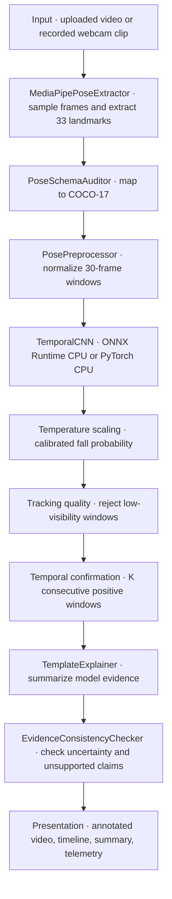

# System architecture

VisionGuard Lite analyzes bounded video clips on the host CPU. It extracts pose landmarks, classifies temporal windows, applies a tracking-quality and confirmation policy, and presents results for human review. The Gradio demo is a recorded-clip research workflow, not a continuous monitoring or emergency response service.

## Processing pipeline



The default settings are K=2, a fall-probability threshold of 0.50, and ONNX Runtime. Temperature is read from checkpoint metadata, with 1.627 as the fallback. These values are research settings and do not imply clinical calibration.

## Module ownership

| Layer | Location | Responsibility |
| --- | --- | --- |
| Application | `demo/app.py` | Load artifacts, validate requests, orchestrate analysis, generate outputs, launch server |
| Presentation | `demo/ui.py`, `demo/style.css` | Controls, result cards, review tabs, responsive styling |
| Pose extraction | `src/inference/mediapipe_extractor.py` | Decode and sample video, extract landmarks, draw skeletons, release capture resources |
| Schema mapping | `src/data/pose_schema_audit.py` | Map MediaPipe landmarks to the classifier's COCO-17 order |
| Preprocessing | `src/data/preprocessing.py` | Hip centering, torso scaling, and temporal feature preparation |
| Classification | `src/models/temporal_cnn.py` | Two-class temporal neural network |
| Explanations | `src/inference/slm_explainer.py` | Deterministic summaries and rule-based consistency checks |
| Research evaluation | `src/evaluation/`, `experiments/gmdcsa24_real/` | Metrics, calibration experiments, benchmarks, and LOSO evaluation |

The standalone uncertainty utilities in `src/evaluation/uncertainty.py` also support research experiments. The demo applies its visibility, probability-band, and confirmation rules in its orchestration layer; it does not call the generic entropy rejection policy.

## Data representations

| Stage | Shape | Meaning |
| --- | --- | --- |
| Extracted landmarks | `(T, 33, 4)` | MediaPipe x, y, z, visibility |
| Mapped pose | `(T, 17, 3)` | COCO-17 x, y, visibility |
| Classifier input | `(1, 51, 30)` | 17 joints × 3 channels over 30 frames |
| Classifier output | `(1, 2)` | Non-fall and fall logits |

### Landmark alignment

MediaPipe coordinates are explicitly mapped before constructing classifier features:

| Joint group | MediaPipe indices | COCO-17 indices |
| --- | --- | --- |
| Nose | 0 | 0 |
| Eyes | 2, 5 | 1, 2 |
| Ears | 7, 8 | 3, 4 |
| Shoulders | 11, 12 | 5, 6 |
| Elbows | 13, 14 | 7, 8 |
| Wrists | 15, 16 | 9, 10 |
| Hips | 23, 24 | 11, 12 |
| Knees | 25, 26 | 13, 14 |
| Ankles | 27, 28 | 15, 16 |

### Normalization and windowing

Skeleton x/y coordinates are centered on the mid-hip and scaled by torso length. Visibility remains a separate feature. This reduces sensitivity to position and scale; it does not eliminate changes caused by viewpoint, occlusion, or camera geometry.

The extractor targets 10 FPS using a frame-selection step. The actual sampling rate is the source FPS divided by that step; window times and output-video FPS use this actual rate. Processing stops at 250 sampled frames. Each classifier window has 30 frames, with a five-frame stride. Clips with 10–29 sampled frames are padded by repeating the last pose; shorter clips return an error.

At exactly 10 sampled FPS, windows span three seconds and start every 0.5 seconds. For other source rates, the physical durations differ. The current implementation does not resample all inputs to exactly 10 FPS.

## Decision policy

For each window, calculate its mean COCO-17 visibility and temperature-scaled fall probability. A window counts as positive only when visibility is at least 0.50 and probability meets the selected threshold.

```text
For each window:
    if visibility >= 0.50 and fall_probability >= threshold:
        consecutive_positives += 1
    else:
        consecutive_positives = 0

    confirmed = consecutive_positives >= K
```

The clip summary uses this order:

1. Mean clip-wide visibility below 0.50: uncertain, regardless of peak probability.
2. Any confirmed window: confirmed fall event under the selected policy.
3. Any raw probability above threshold: unconfirmed spike.
4. Peak probability in the ambiguity band `[0.35, threshold)`: uncertain.
5. Otherwise: normal activity according to the classifier.

K accepts values from 1 to 4, and the probability threshold accepts values from 0.20 to 0.90. K=1 still requires usable tracking. A non-positive or low-visibility window resets the confirmation run.

**Confirmation policy delay** is the elapsed video time between the first positive window in the first confirming run and its confirmation window. Earlier rejected spikes do not contribute. At 10 FPS, K=2 adds one stride (0.5 seconds) after the first positive window. This excludes the initial window duration and is not a measurement from physical fall onset.

Frame banners use the latest window available at that frame's timestamp. Frames preceding the first completed window show a collection status. The summary covers the full analyzed clip and may differ from an individual frame's banner.

## Explanations and safety boundaries

The demo uses `TemplateExplainer`, a deterministic local rule engine. Its summaries describe classification and uncertainty without asserting an observed injury or measured ground contact. `EvidenceConsistencyChecker` checks uncertainty language, fall alignment, and a list of unsupported medical claims. The check result is included in diagnostics; it does not establish medical validity or guarantee that all unsupported statements can be detected.

`QwenSLMExplainer` is an optional research implementation, not a selectable demo backend. Its model-loading path may require network access and additional dependencies. Do not assume that the active demo uses an autoregressive language model or quantized language-model inference.

## Outputs, concurrency, and resources

Each run creates a unique directory in the system temporary location for its timeline image and annotated video. Independent runs do not overwrite one another's artifacts. The plot uses its own Matplotlib figure, and Gradio queues analysis requests with a concurrency limit of one. Video capture, pose extraction, and encoding resources are released on handled failures.

Gradio maintains its own cached copies of served files and is configured to clean eligible cache entries hourly after an hour. Pipeline source artifacts in the system temporary directory have a separate operating-system lifecycle; the app does not promise secure deletion or a complete retention policy. Use appropriate host storage controls for sensitive footage.

The launcher defaults to `127.0.0.1` and disables sharing unless explicitly requested. There is no authentication configured by default. Deliberately exposing the service changes who may upload and retrieve video and requires an appropriate deployment boundary.

## Verification

The automated suite exercises mapping and preprocessing, classifier shapes, real-model ONNX/PyTorch parity, both inference backends, state decisions, confirmation resets, sample timing, low visibility, unique outputs, resource cleanup, encoding errors, and interface configuration. See the [README](../README.md#development-and-verification) for commands and [historical benchmarks](benchmarks.md) for earlier research results.
